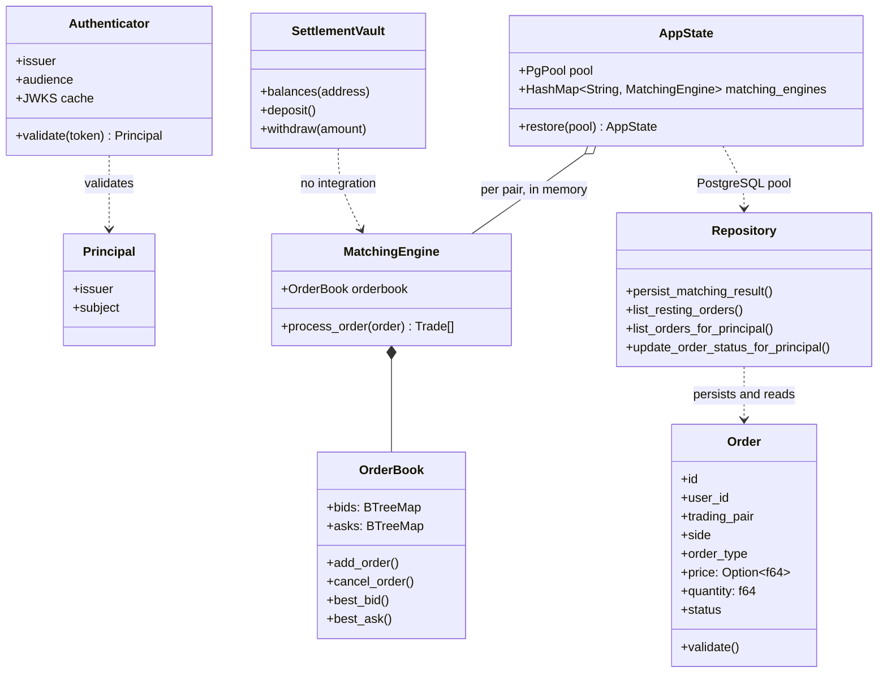

# Core component/class relationships

This is a compact source-oriented view, not an exhaustive UML inventory.

`Order` is the API/serialized record; engine `shared::Order` instead represents price and quantity as `i64`. Repository implementations use PostgreSQL; there is no contract class relationship in the running API.