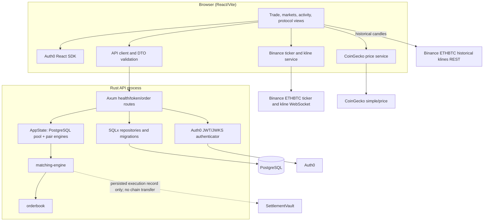

# Component diagram

Solid edges are implemented calls/data flows. Dotted edges explicitly mark non-integration.

The backend API does not expose orderbook or trade query endpoints. The vault component is shown to identify the boundary, not a runtime dependency.