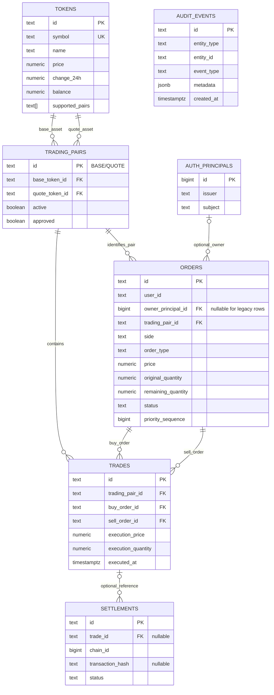

# PostgreSQL schema

The SQLx migrations in `backend/migrations/` create these relations. Monetary fields are PostgreSQL `NUMERIC(38,18)`. This schema does not imply that an on-chain settlement flow exists.

`trades` references the buy/sell orders together with the same pair using composite foreign keys. `orders.owner_principal_id` was added nullable so legacy rows remain unassigned; they are not automatically mapped to a login identity. Issuer/subject pairs in `auth_principals` are unique.

`settlements` and `audit_events` are database structures only. There is no settlement API/worker, chain observer, or transaction-confirmation flow. Audit writes cover code paths that explicitly call the repository audit helper; do not assume every failed or successful HTTP request is logged.

The API does not expose token-list, pair-list, trade-list, or settlement-list routes. Startup inserts missing demo tokens and pairs using `ON CONFLICT DO NOTHING`; this does not refresh existing seeded rows.