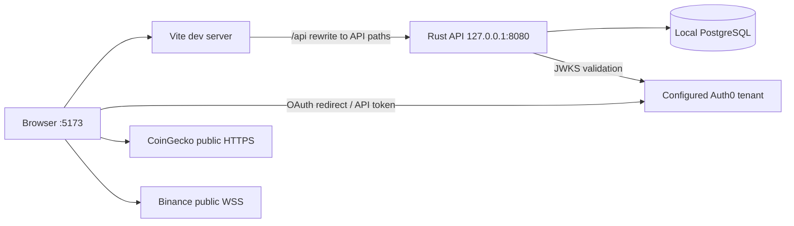
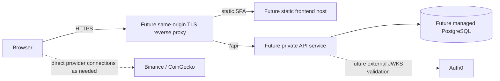

# Deployment topology and current status

## Verified local development topology

The frontend's Vite proxy removes the `/api` prefix. The API binds to loopback and has no CORS middleware. PostgreSQL migrations and non-destructive demo seed inserts run when the API starts.

## Planned deployment shape (not configured or tested)

Every component in the lower diagram is a planning illustration, not repository infrastructure. There is no Dockerfile/Compose, Terraform, deployment manifest, checked-in CI workflow, or recorded deployed environment. See [deployment guide](../05-deployment/deployment-guide.md).