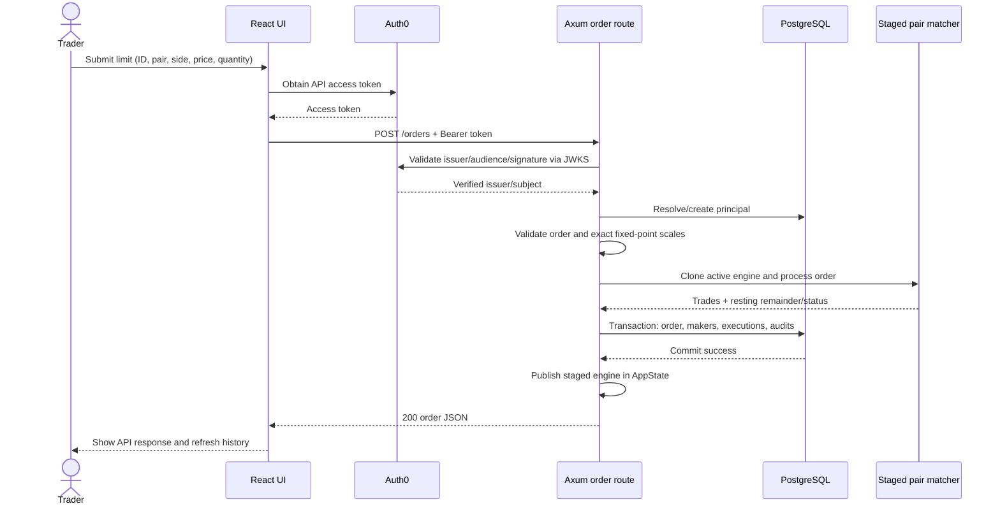
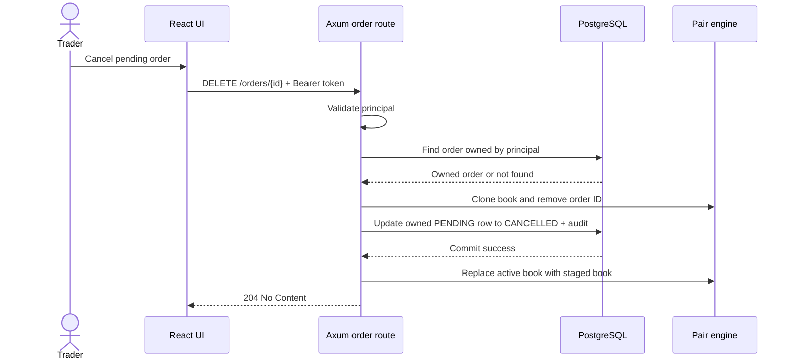

# Order lifecycle sequence diagrams

## Submission, matching, and persistence

If database persistence fails, the staged engine is not installed. Memory and database still do not form a distributed transaction, and no durable execution outbox exists.

## Cancellation

Cancellation cannot settle, refund, or release a wallet balance: no balance reservation is implemented.