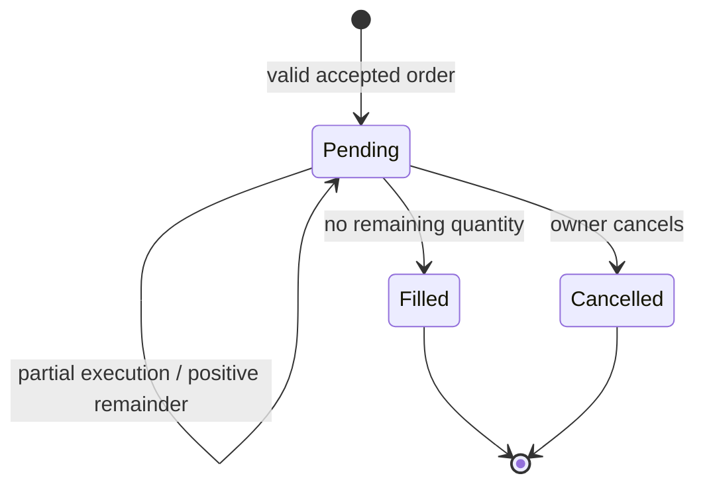
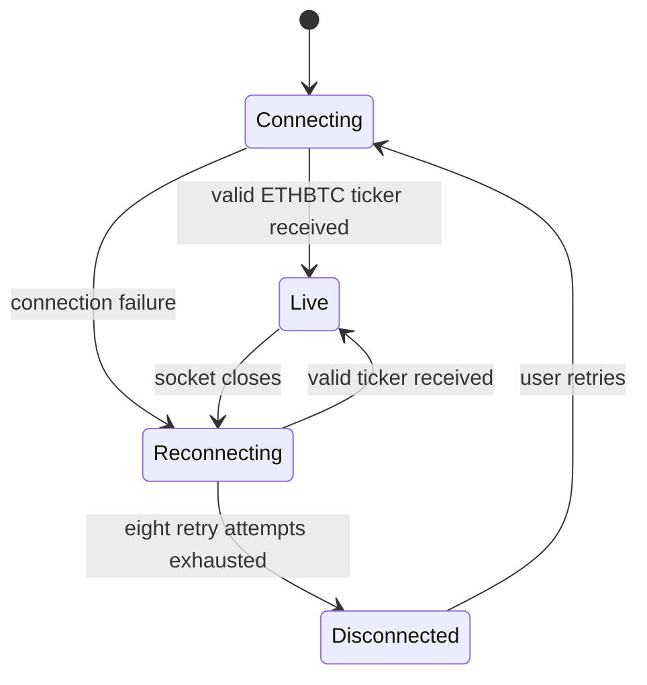

# Order-state and external-data states

## Persisted order status

The API database constraint permits `PENDING`, `FILLED`, and `CANCELLED`. The API only creates limit orders as `PENDING`, then matcher persistence can set `FILLED` when remaining quantity reaches zero. Cancellation updates only a pending order.

`Market` appears in enum/schema definitions but is rejected by the matcher adapter; it is not a working order type. A `Filled` state is an off-chain matching result, not settlement finality.

## Frontend Binance stream

The frontend retains the last observed price and indicates staleness on connection loss. CoinGecko REST has separate loading/live/stale/error states; neither feed is an orderbook or trade API.