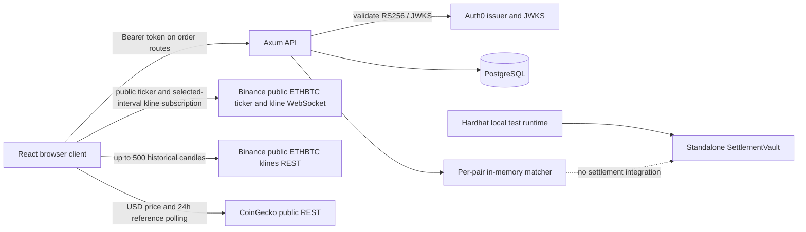

# System architecture (as implemented)

## Runtime components

- **Browser:** React/Vite client. Auth0 SPA handles application login/token retrieval. Order forms use the DexSYS API; public token reads are unauthenticated. It independently fetches CoinGecko USD references and Binance ETHBTC klines, and subscribes to the combined Binance ETHBTC ticker/kline stream.
- **HTTP API:** Rust/Axum service bound to `127.0.0.1:8080`. Health and token routes are public. Only `/orders` routes have Auth0 middleware.
- **Persistence:** PostgreSQL through SQLx. Startup applies embedded migrations, seeds missing ETH/BTC metadata and ETH/BTC plus BTC/ETH pairs, then restores pending limits.
- **Matching:** `matching-engine` processes price crossings against a `orderbook` instance held in shared API state per pair. `shared` contains engine order types. Engine memory is local to the API process.
- **Contract workspace:** Hardhat compiles/deploys contracts to simulated networks for tests. `SettlementVault` is not called by the API or frontend.

## Request and data boundaries

## Important consistency boundary

For order creation, the API stages matching on a cloned book, stores the new order, affected makers, executions, and audit rows in a database transaction, then replaces the process's active book after commit. This prevents a failed database transaction from publishing the staged change in that process. It does not make PostgreSQL and memory a distributed transaction. Startup rebuilds books from pending limit rows, but does not replay old executions or provide a durable outbox/reconciliation protocol.

## Current exclusions

No service mesh, load balancer, CORS layer, deployment configuration, wallet integration, AMM, public book/trades endpoint, settlement worker, or on-chain trade settlement is present. See [deployment guide](../05-deployment/deployment-guide.md).